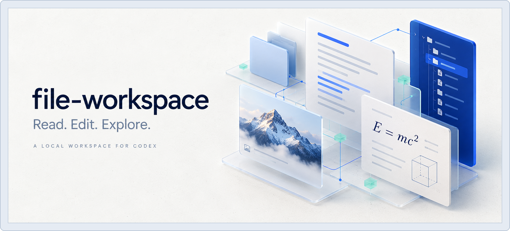
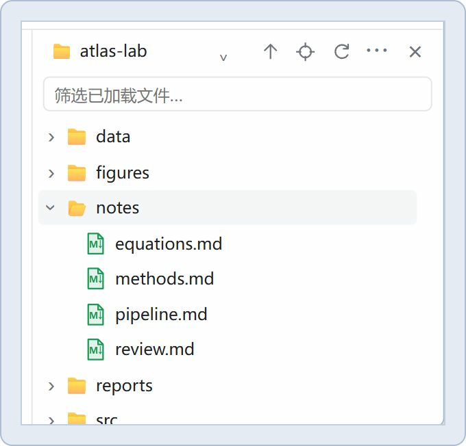
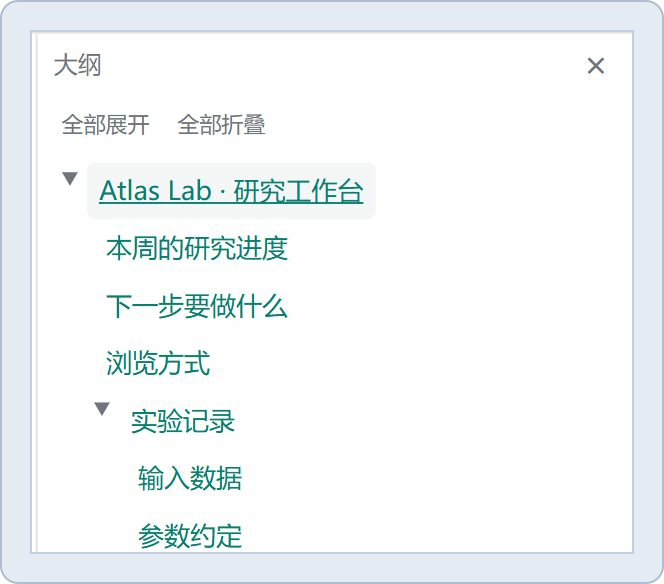
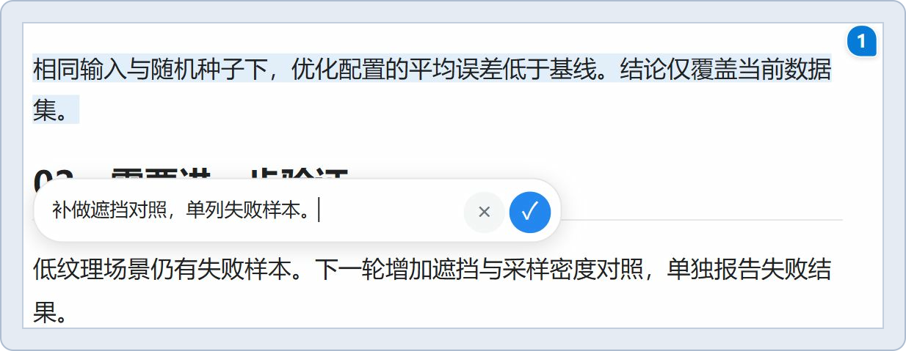
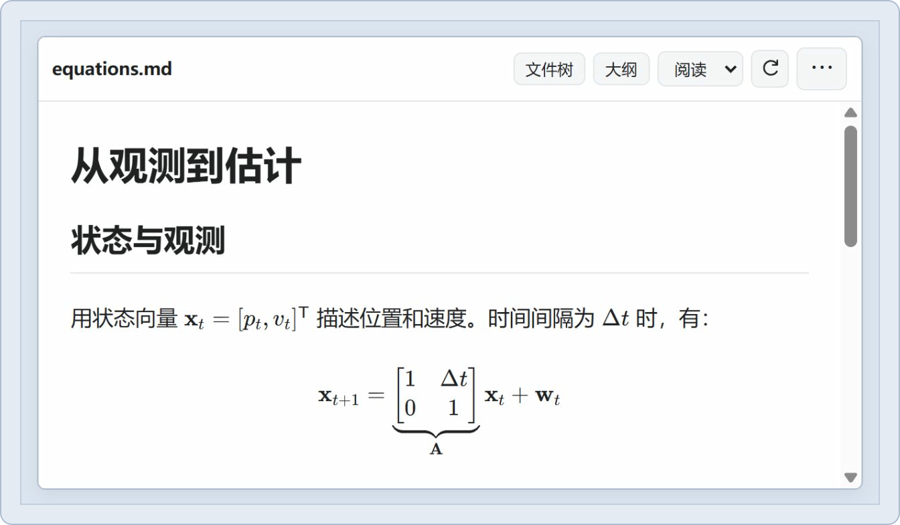
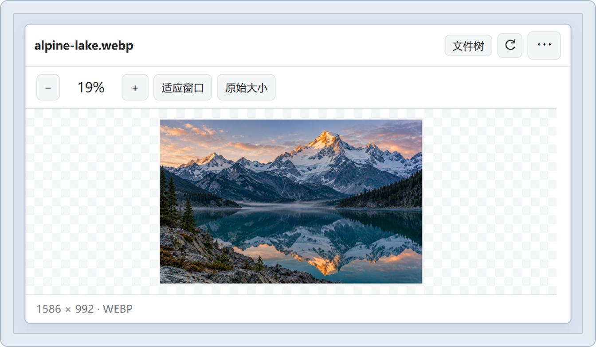
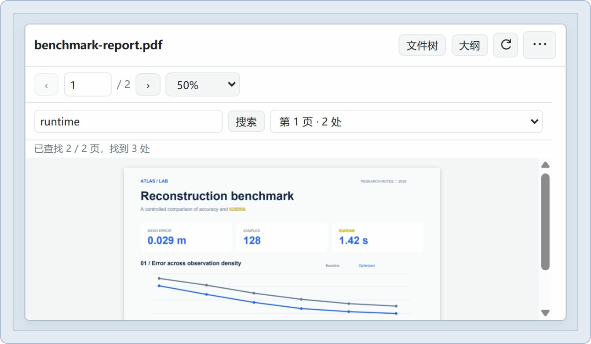
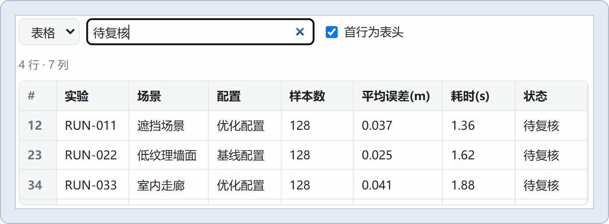
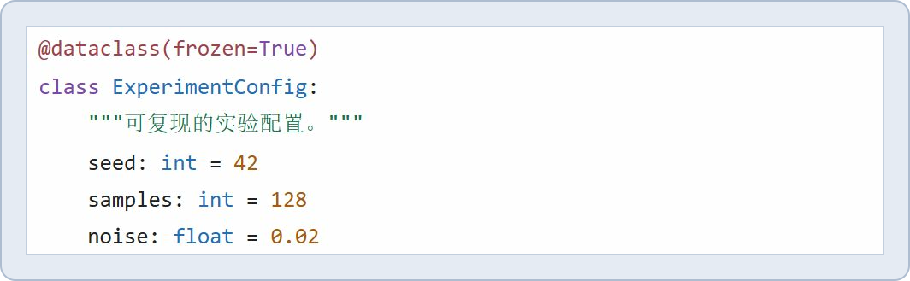

<div align="center">

<h1>Give Codex a sidebar superpower.</h1>

<p align="center"><a href="docs/images/showcase/cover.webp"></a></p>

<p><strong>Switch files. Inspect details. Edit Markdown. Keep ideas moving.</strong></p>

<p>
  <a href="https://github.com/HuSiyue-ai/file-workspace/actions/workflows/check.yml"></a>
  <a href="https://github.com/HuSiyue-ai/file-workspace/tags"></a>
  <a href="LICENSE"></a>
</p>

<p><a href="README.md">简体中文</a> · <strong>English</strong></p>

<p><a href="#browse-your-project">Browse</a> · <a href="#edit-and-discuss">Edit & discuss</a> · <a href="#read-each-format">File previews</a> · <a href="#installation">Install</a> · <a href="https://github.com/HuSiyue-ai/file-workspace/issues">Feedback</a></p>

</div>

## Keep your files in step with your ideas.

One report. A dozen supporting files. Equations in notes, measurements in a CSV, evidence in images and PDFs. An idea arrives - then you have to find a file, switch tabs, and compare source before you can follow it through.

**file-workspace puts that whole sequence in one Codex sidebar.**

- **Jumping between documents?** Open the project tree and click through files, keeping folders and reading context within reach.
- **Struggling to inspect the details?** Read typeset math, inline diagrams, zoomable images, searchable PDFs, and filterable tables.
- **Ready to change a passage or ask a better question?** Edit the active block in place. Select the evidence, add your comment, and bring both into a chat draft.

It started as a Markdown equation preview. Everyday reading friction gradually shaped it into a workspace: **switch files, inspect details, edit the document, and discuss the evidence.**

From a single note to an entire project, turn reading into the next useful action.

| Browse your project | Edit and discuss | Read each format |
| :--- | :--- | :--- |
| [File tree](#file-tree-switch-files-without-losing-context) · [Outline](#outline-navigate-the-structure-of-a-document) | [Block editing](#block-editing-reveal-only-the-source-you-need) · [Comments](#selection-comments-keep-a-question-with-its-passage) | [Math](#math-keep-the-derivation-in-the-document) · [Diagrams](#diagrams-inline-readable-and-zoomable) · [Images](#images-from-the-full-frame-to-the-details) · [PDF](#pdf-search-the-report-jump-to-a-bookmark) · [Tables](#csv--tsv-filter-first-then-read) · [Code](#code-highlighted-and-read-only) |

## Browse your project

### File tree: switch files without losing context

Notes, data, figures, and reports sit together in the project tree. Single-click a file to replace the **current preview**, preserving expanded folders, tree width, and position within the page session.

<p align="center"><a href="docs/images/showcase/retina/01-tree-2x.jpg"></a></p>

- **Click a folder** to expand or collapse it; **double-click** to enter. Use `↑` to go up, or the locate button to find the active file.
- Switch roots through the project menu. Filtering searches loaded names rather than scanning your whole drive.
- Drag the divider to resize the tree; collapse it to restore the document's full width. Both areas scroll independently.
- Right-click to copy a path, add a file to chat, or open it through the host. Create subfolders from a folder's menu. Double-clicking a file also hands it to the host.

### Outline: navigate the structure of a document

The tree shows where your material lives; the outline shows where you are inside it. Open **Outline** to browse headings by level and jump straight to a section.

<p align="center"><a href="docs/images/showcase/retina/10-outline-2x.jpg"></a></p>

- Expand individual sections or expand / collapse the entire heading hierarchy.
- The active section follows your reading position as the document scrolls.
- The outline shares the resizable sidebar with the file tree; switch or hide it whenever needed.

## Edit and discuss

### Block editing: reveal only the source you need

**Read** mode locks the document for browsing and selection. Switch to **Edit**, then click a paragraph, list, or code block. Only that block reveals its Markdown; surrounding headings, equations, and images stay rendered.

<p align="center"><a href="docs/images/showcase/retina/02-editor-2x.jpg"></a></p>

1. Select **Edit** and click a block. For ordinary text and code, the editor attempts to place the caret at the clicked position.
2. Change the text, then click another block. The previous one renders again and the next reveals its source.
3. Use **Source** mode for whole-document changes. Undo and redo are supported.
4. Click **Save** or press `Ctrl+S` to write to disk. An external-change conflict prevents an overwrite; the original file is backed up before saving.

The screenshot shows `**预测位置**` and `$e$` as source while the display equation stays rendered. Editing supports existing UTF-8 `.md` / `.markdown` documents.

### Selection comments: keep a question with its passage

Keep the quotation and your own thought separate, collect several passages, then add them to the conversation together. Confirmed comments appear as numbered bubbles you can revisit.

<p align="center"><a href="docs/images/showcase/retina/05-comments-2x.jpg"></a></p>

1. Select text, click **Comment…**, and enter a question or requested change in the compact input.
2. Confirm with `✓` to keep a numbered bubble, then continue selecting passages.
3. Open **Comments N** in the toolbar to edit individual comments or remove quotations.
4. Choose **Add to chat draft** to include each quote with its comment. **Nothing is sent automatically.**

Comments live in the current tab's memory and disappear when it closes. They are not permanent Markdown annotations or native host comment cards.

## Read each format

### Math: keep the derivation in the document

Inline equations flow with the sentence; display equations get their own space. Matrices, fractions, integrals, and scripts are rendered locally with KaTeX.

<p align="center"><a href="docs/images/showcase/retina/03-math-2x.jpg"></a></p>

- Use `$...$` for inline math and `$$...$$` for display math.
- Mix equations into paragraphs, lists, blockquotes, and tables.
- Edit the original Markdown / LaTeX source; rendered output does not replace the document text.

Try the [equation notes](examples/atlas-lab/notes/equations.md).

### Diagrams: inline, readable, and zoomable

Mermaid code blocks become diagrams inside the document. Inspect the workflow, then keep reading the explanation immediately below it.

<p align="center"><a href="docs/images/showcase/retina/04-mermaid-vector.svg"></a></p>

- Hover or focus the diagram to reveal `−`, `+`, and reset controls.
- Use `Ctrl` / `⌘` + wheel to zoom, then drag to pan.
- Zoom retains the diagram's allocated height rather than pushing the following text down.
- Read mode shows the diagram; edit and source modes retain its definition. A parsing error leaves the source available for inspection.

Try the [data pipeline](examples/atlas-lab/notes/pipeline.md).

### Images: from the full frame to the details

Open images in the same workspace. Fit the complete image, then zoom in to inspect a screenshot, figure, or photograph.

<p align="center"><a href="docs/images/showcase/retina/06-images-2x.jpg"></a></p>

- Wheel zoom is centered on the pointer; drag after zooming in. The toolbar offers `−`, `+`, fit-to-window, and actual size.
- Double-click to switch fit / actual size. Focus the image area to use keyboard zoom and pan shortcuts.
- Pixel dimensions and format are shown. PNG, JPEG, GIF, WebP, SVG, BMP, ICO, and AVIF decoding depends on the host.
- Markdown embeds support local relative paths, spaces and Chinese characters in paths, reference images, and Obsidian image syntax.

The [alpine sample](examples/atlas-lab/figures/alpine-lake.webp) is AI-generated artwork used to demonstrate the viewer.

### PDF: search the report, jump to a bookmark

Click a PDF in the tree and keep reading on the same page. Navigate by page number, zoom level, bookmark, or a cross-page text search.

<p align="center"><a href="docs/images/showcase/retina/07-pdf-2x.jpg"></a></p>

- Move between pages or enter a page number; select fit-to-width or a fixed zoom level.
- Search for a word, choose a matching page, and see its occurrences highlighted.
- Open **Outline** to navigate the document's own bookmarks.
- Rendering runs in a separate PDF process, with optional `pypdfium2` and `Pillow` dependencies.

Try the [fictional benchmark report](examples/atlas-lab/reports/benchmark-report.pdf). Pages are displayed as images; PDF text selection, OCR, forms, and annotations are not supported.

### CSV / TSV: filter first, then read

Inspect experiment logs and exported data without first opening a spreadsheet app. The viewer provides columns, filtering, pagination, and a raw-text view.

<p align="center"><a href="docs/images/showcase/retina/08-csv-2x.jpg"></a></p>

- Filter the loaded table by a keyword while retaining original row numbers for reference.
- Toggle whether the first row is a header, and page through longer tables.
- Switch between **Table** and **Raw text** to inspect delimiters and original content.
- This is a read-only viewer: it does not edit cells or evaluate formulas. Size and row / column limits are reported rather than silently ignored.

Try the [48-record CSV](examples/atlas-lab/data/benchmark.csv). All data is fictional.

### Code: highlighted and read-only

Jump from a document into its implementation. Syntax highlighting distinguishes functions, strings, comments, and keywords.

<p align="center"><a href="docs/images/showcase/retina/09-code-2x.jpg"></a></p>

- Language detection follows the file type; ordinary UTF-8 text is also readable.
- Highlighting assets ship with the plugin, without runtime CDN requests.
- Source is read, not executed. Use an external editor to change code files.
- Notebooks currently show raw JSON; Office files, audio, video, and other unsupported formats are handed to the host.

Try the [Python sample](examples/atlas-lab/src/reconstruct.py).

## Installation

**Primary tested environment: Windows.** Requires Python **3.12+**, Codex desktop with local plugins and MCP App file entries, and a CLI supporting `codex plugin`. Native dialogs require Tkinter. Node.js is not required for everyday use.

### 1. Clone, build, and check

Choose a directory you intend to keep, then run in PowerShell:

```powershell
git clone https://github.com/HuSiyue-ai/file-workspace.git
cd file-workspace
python build.py
python doctor.py
```

### 2. Register the local plugin

Continue from the repository root:

```powershell
codex plugin marketplace add .
codex plugin add markdown-math-preview@markdown-preview-local
```

The display name is **file-workspace**. Commands retain the legacy internal ID for compatibility. Build locally first; the GitHub URL alone is not a ready-to-install remote plugin source.

### 3. Open it in the sidebar

Fully quit Codex, including the tray process, then restart. Open a Markdown file or image in the sidebar and choose the in-app **file-workspace** viewer from its **Open** menu. Use the tree to continue browsing.

Alternatively, enter a blank workspace through the plugin tool entry on a new tab and choose a project folder. Entry placement varies by host version. See the [installation guide](docs/installation.md) for updates, rollback, and uninstall steps.

<details>
<summary><strong>Enable PDF previews</strong></summary>

```powershell
python -m pip install -r requirements-pdf.txt
```

Run `python doctor.py` to inspect the actual PDF Python environment. The plugin prefers an available Codex PDF runtime, then the build interpreter. Override it with `FILE_WORKSPACE_PDF_PYTHON`. The doctor only checks; it does not install software or change settings.

</details>

## Data, saves, and compatibility

- **Local rendering.** The plugin does not upload files, fetch remote images, or execute document code. Quotations explicitly added to chat enter its draft and are then handled by Codex.
- **Explicit saves.** Original-file versions are checked and backups go to `~/.codex/backups/file-preview/`. Unsaved drafts and in-memory comments are not permanent backups.
- **Access boundaries.** A selected file or project establishes an anchor; subsequent browsing can reach the same drive. **This is not a project-directory sandbox.** UNC / network shares are unsupported.
- **Host compatibility.** Native tabs usually display the plugin name; the active file name appears in the plugin toolbar. Project detection and chat-draft entry points depend on the host. Manual folder selection remains available.

See [support and limitations](docs/limitations.md) for format and size limits. This independent project is evolving; every Codex desktop version has not been validated.

## Documentation and development

[Installation](docs/installation.md) · [Limitations](docs/limitations.md) · [Architecture](docs/architecture.md) · [Changelog](CHANGELOG.md) · [Contributing](CONTRIBUTING.md) · [Visual assets](docs/visuals.md)

Detailed guides are currently in Chinese. This README covers everyday use and installation in English.

<details>
<summary><strong>Run development checks</strong></summary>

Requires Python 3.12+ and Node.js:

```powershell
python -m pip install -r requirements-dev.txt
python build.py
python check.py --require-pdf
```

Without PDF dependencies, run `python check.py` for the other checks. `python dev_preview.py` provides an isolated UI bound only to `127.0.0.1`, intercepting chat-draft requests so they do not reach real conversations. It does not replace desktop-host compatibility testing.

</details>

## License and acknowledgements

[MIT](LICENSE) © HuSiyue-ai. Third-party components retain their licenses; see [third-party notices](THIRD-PARTY-NOTICES.md).

Built with Marked, KaTeX, Mermaid, DOMPurify, highlight.js, pypdfium2, and other open-source components. Designed, tested, and maintained by **HuSiyue-ai** around everyday needs, with AI-assisted development. Not affiliated with or endorsed by OpenAI.

The cover is AI-generated concept artwork. Feature visuals use two-times display rendering of the real viewer in an isolated demo host, plus native Mermaid SVG output. They use a fictional project and data. Click a framed image to view its original; see the visual asset notes for capture details.
