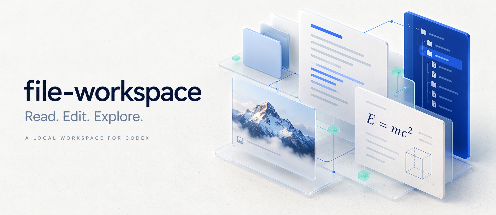
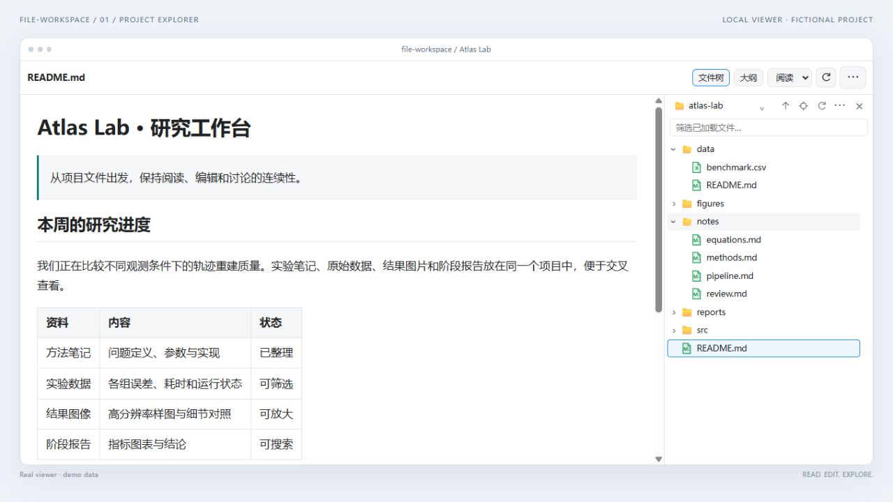
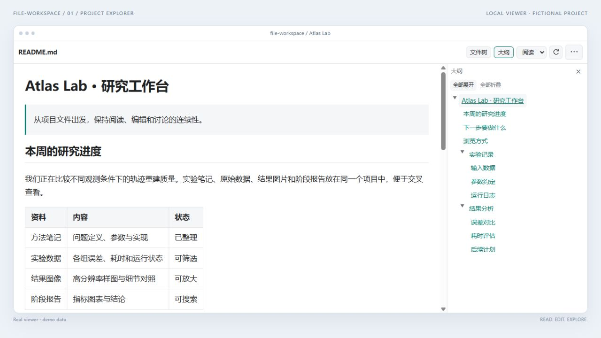
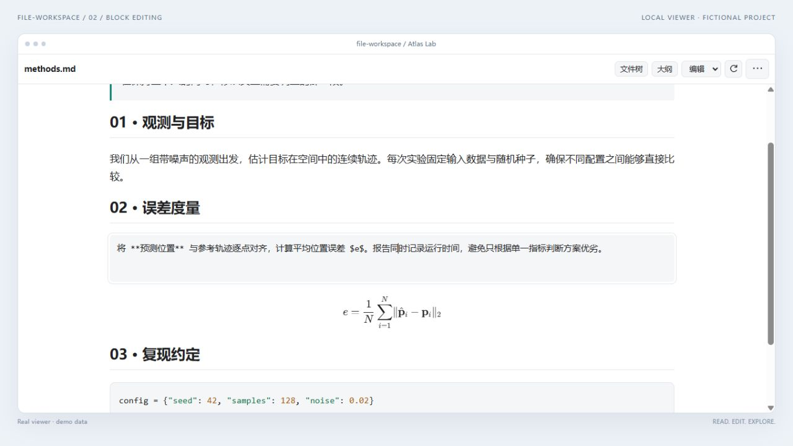
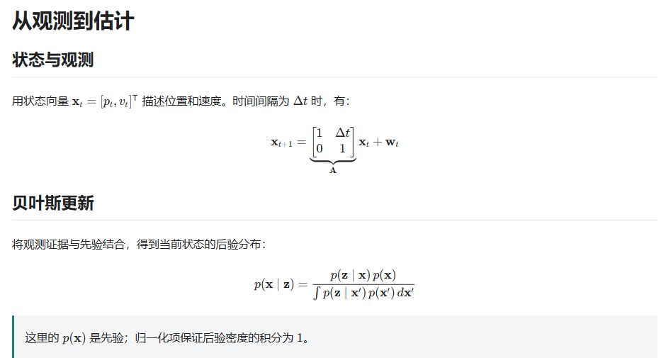
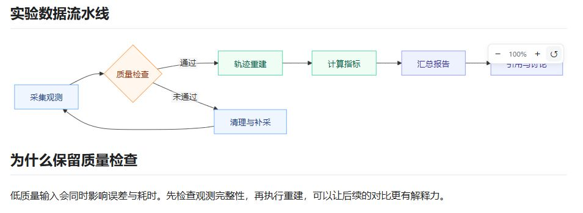
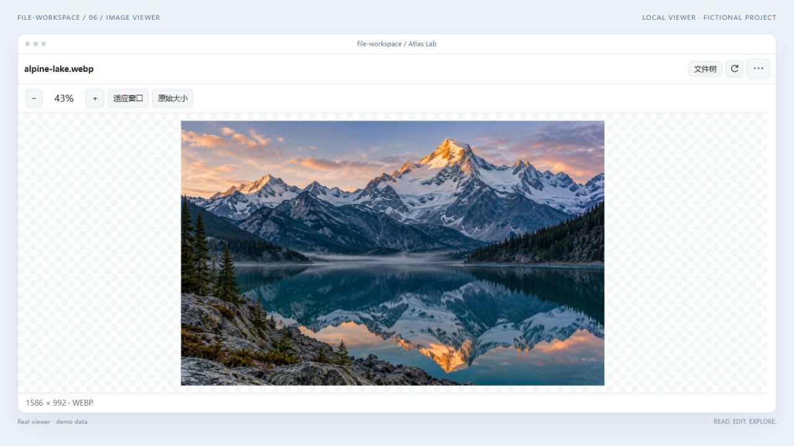
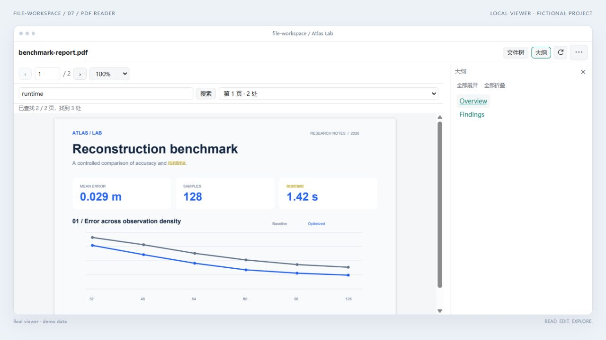
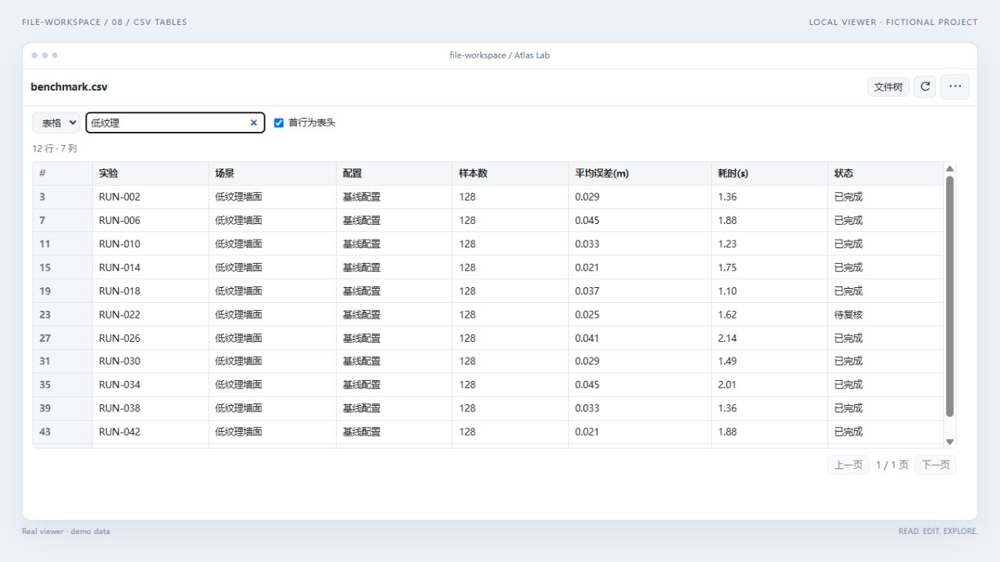
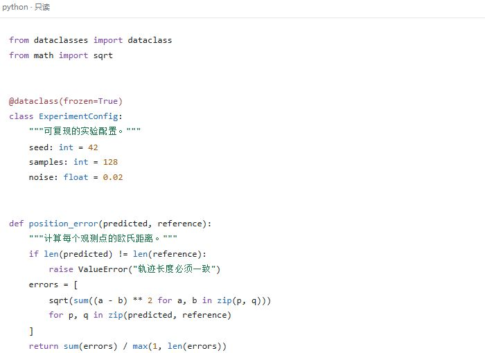

<div align="center">

<table><tr><td><a href="docs/images/showcase/cover.webp"></a></td></tr></table>

<p><strong>在 Codex 右侧，把文件看清，把想法写下。</strong></p>

<p>
  <a href="https://github.com/HuSiyue-ai/file-workspace/actions/workflows/check.yml"></a>
  <a href="https://github.com/HuSiyue-ai/file-workspace/tags"></a>
  <a href="LICENSE"></a>
</p>

<p><strong>简体中文</strong> · <a href="README.en.md">English</a></p>

<p><a href="#浏览项目">浏览项目</a> · <a href="#编辑与讨论">编辑与讨论</a> · <a href="#多格式阅读">多格式阅读</a> · <a href="#安装">安装</a> · <a href="https://github.com/HuSiyue-ai/file-workspace/issues">反馈</a></p>

</div>

## 一次阅读，往往不止一个文件

你正在和 Codex 整理一份实验报告：方法写在 Markdown 里，结果是几张截图，数据在 CSV 中，参考材料又是一份 PDF。读到一个结论，你想放大图里的细节，回头核对数据，再对原文补一句修改意见。

资料之间的联系很自然，阅读过程却容易被小操作打断：

- **找得到，还要切得顺。** 刚展开的目录、刚读到的位置，应该能跟着你继续浏览；每点一个文件就多一个标签，很快就会失去上下文。
- **打开了，还要看得清。** 公式需要正确排版，流程图需要放大，本地图片需要正常加载，表格需要筛出相关的几行。
- **看懂了，还要改得到、说得准。** 修改某段文字时，希望周围内容仍可阅读；提出问题时，希望引用和评论能对应到具体段落。

file-workspace 最初从 Markdown 公式预览开始。随着本地图片、文件树、块编辑和逐段评论逐步补齐，它变成了一个放在 Codex 右侧的本地工作台：**沿着同一个项目浏览资料，在读到的位置修改，把带着证据的问题交给对话。**

下面按「浏览项目 → 编辑与讨论 → 多格式阅读」展示这条工作流，每项功能都有独立配图和可试用的示例。

| 浏览项目 | 编辑与讨论 | 多格式阅读 |
| :--- | :--- | :--- |
| [文件树](#文件树连续切换保留上下文) · [文章大纲](#文章大纲按结构阅读长文) | [块编辑](#块编辑只展开正在修改的那一段) · [选区评论](#选区评论把问题放在对应的段落旁) | [公式](#公式让推导回到正文中) · [流程图](#流程图内嵌正文放大看细节) · [图片](#图片从完整构图到局部细节) · [PDF](#pdf读报告查关键词跳书签) · [表格](#csv--tsv先筛选再阅读) · [代码](#代码高亮阅读保持只读) |

## 浏览项目

### 文件树：连续切换，保留上下文

打开项目后，笔记、数据、图片和报告并排出现在目录中。单击文件即可在**当前预览页**切换，目录的展开状态、宽度与位置会在本次页面中保留。

<table><tr><td><a href="docs/images/showcase/01-file-tree.png"></a></td></tr></table>

- **单击文件夹**展开 / 收起，**双击文件夹**进入；用 `↑` 返回上级，用定位按钮找到当前文件。
- 从项目下拉菜单切换根目录；按已加载的名称筛选文件，不扫描整个磁盘。
- 拖动左边界调整目录宽度，收起目录后正文恢复全宽，两侧独立滚动。
- 右键文件可复制路径、加入聊天或交给宿主打开；右键文件夹可新建子文件夹。双击文件同样交给宿主处理。

### 文章大纲：按结构阅读长文

文件树回答“资料在哪里”，大纲回答“这篇文档讲到哪里”。点击「大纲」，标题按层级展开；点击标题直接跳转到相应位置。

<table><tr><td><a href="docs/images/showcase/10-outline.png"></a></td></tr></table>

- 保留 Markdown 的标题层次，可单独展开章节，也可全部展开 / 折叠。
- 当前阅读位置随正文滚动更新，长篇报告不必反复拖动滚动条。
- 大纲与文件树共用可调整宽度的侧栏，随时切换或收起。

## 编辑与讨论

### 块编辑：只展开正在修改的那一段

「阅读」模式锁定内容，适合选文与浏览。切到「编辑」后，点击一个段落、列表或代码块，只展开该块的 Markdown 源码；周围的标题、公式和图片继续保持渲染。

<table><tr><td><a href="docs/images/showcase/02-block-editing.png"></a></td></tr></table>

1. 在模式菜单选择「编辑」，点击需要修改的块；普通文字和代码尽量按点击位置放置光标。
2. 修改文本后，点击其他块；上一块恢复排版，新一块展开源码。
3. 需要调整整篇结构时，切换到「源码」模式；支持撤销 / 重做。
4. 点击「保存」或按 `Ctrl+S` 才写回文件。外部修改冲突会阻止覆盖，保存前会备份原文件。

图示可见 `**预测位置**` 与 `$e$` 的源码，以及仍保持排版的块级公式。支持编辑已有的 UTF-8 `.md` / `.markdown` 文档。

### 选区评论：把问题放在对应的段落旁

引用和自己的意见可以分开写，也可以收集多段后一起加入对话。确认过的评论显示为编号气泡，点击可回来修改。

<table><tr><td><a href="docs/images/showcase/05-comments.png"></a></td></tr></table>

1. 选中文字，点「评论…」，在小输入框中补充问题或修改要求。
2. 点 `✓` 确认，段落旁保留编号气泡；也可继续选择下一段。
3. 顶部「批注 N」打开汇总面板，逐条修改评论或移除引用。
4. 点「加入聊天草稿」，引用与对应评论一起进入当前对话，**不会自动发送**。

评论暂存在当前标签内存中，关闭标签会清除；它不是写入 Markdown 的永久批注，也不等同于宿主原生评论卡片。

## 多格式阅读

### 公式：让推导回到正文中

行内公式跟着句子走，块级公式独立排版。矩阵、分式、积分和上下标都由本地 KaTeX 渲染，不必把推导拆成图片。

<table><tr><td><a href="docs/images/showcase/03-math-detail.png"></a></td></tr></table>

- 支持 `$...$` 行内公式与 `$$...$$` 块级公式。
- 可以在段落、列表、引用和表格中混排公式。
- 编辑时仍修改原始 Markdown / LaTeX 源码，渲染结果不替换原文。

试用：[公式笔记](examples/atlas-lab/notes/equations.md)。

### 流程图：内嵌正文，放大看细节

Mermaid 代码块直接变成文档中的图，不需要另外弹出一个绘图窗口。图上方可缩放，图下方继续阅读解释。

<table><tr><td><a href="docs/images/showcase/04-mermaid.png"></a></td></tr></table>

- 悬停或聚焦图表后显示 `−` / `+` / 重置按钮。
- 按住 `Ctrl` / `⌘` 并滚动滚轮缩放，放大后按住拖动。
- 缩放保持原有占位高度，不把后面的正文顶走。
- 阅读显示图形；编辑与源码模式仍可修改 Mermaid 定义。解析失败时保留源码供排查。

试用：[数据流水线](examples/atlas-lab/notes/pipeline.md)。

### 图片：从完整构图到局部细节

同一工作台可以直接查看图片。先适应窗口看全貌，再放大检查截图、图表或照片中的细节。

<table><tr><td><a href="docs/images/showcase/06-image-viewer.png"></a></td></tr></table>

- 滚轮围绕鼠标位置缩放，放大后按住拖动；工具栏支持 `−` / `+`、适应窗口与原始大小。
- 双击切换适应窗口 / 原始大小；聚焦图片区域后可用键盘缩放和平移。
- 显示像素尺寸与格式；PNG、JPEG、GIF、WebP、SVG、BMP、ICO、AVIF 的实际解码取决于宿主。
- Markdown 嵌图支持本地相对路径、中文与空格路径、引用式图片和 Obsidian 图片语法。

图中的[山水样图](examples/atlas-lab/figures/alpine-lake.webp)由 AI 生成，仅作为图片查看器的演示素材。

### PDF：读报告、查关键词、跳书签

从文件树点开 PDF，仍在同一个页面中阅读。支持页码跳转、不同缩放比例、书签和跨页文字搜索。

<table><tr><td><a href="docs/images/showcase/07-pdf-search.png"></a></td></tr></table>

- 上一页 / 下一页或输入页码跳转，选择适应宽度或固定缩放比例。
- 在搜索框输入关键词，查看命中页并跳转，页面内显示对应高亮。
- 点「大纲」查看 PDF 自带书签，按章节定位。
- 通过独立 PDF 进程渲染；需要可选依赖 `pypdfium2` 与 `Pillow`。

试用：[虚构实验报告](examples/atlas-lab/reports/benchmark-report.pdf)。当前 PDF 以图片页面显示，暂不支持选文、OCR、表单填写与 PDF 批注。

### CSV / TSV：先筛选，再阅读

实验记录或导出的数据表，不必先打开电子表格软件。工作台按列展示，支持筛选、分页和原文切换。

<table><tr><td><a href="docs/images/showcase/08-csv-filter.png"></a></td></tr></table>

- 输入关键词筛选当前载入的表格，保留原始行号，便于回查。
- 可切换首行是否作为表头，按页阅读较长数据。
- 在「表格」与「原文」之间切换，检查分隔与原始内容。
- 这是只读预览，不修改单元格、不运行公式；超出行列与大小限制时会提示。

试用：[48 条实验记录](examples/atlas-lab/data/benchmark.csv)，数据均为虚构示例。

### 代码：高亮阅读，保持只读

查看文档时顺手点开实现文件，函数、字符串、注释与关键字通过语法高亮区分。

<table align="center"><tr><td><a href="docs/images/showcase/09-code.png"></a></td></tr></table>

- 按文件类型识别支持的语言；普通 UTF-8 文本可直接查看。
- 高亮资源随插件打包，运行时不请求 CDN。
- 只读取文本，不运行代码；代码文件编辑可交给外部编辑器。
- Notebook 当前显示 JSON 原文，Office、音视频等交给宿主打开。

试用：[Python 示例](examples/atlas-lab/src/reconstruct.py)。

## 安装

**主要验证环境：Windows。** 需要 Python **3.12+**、支持本地插件与 MCP App 文件入口的 Codex 桌面端，以及支持 `codex plugin` 的 CLI。文件选择对话框需要 Tkinter；日常使用不需要 Node.js。

### 1. 获取、构建、检查

将仓库放在准备长期保留的位置，在 PowerShell 中运行：

```powershell
git clone https://github.com/HuSiyue-ai/file-workspace.git
cd file-workspace
python build.py
python doctor.py
```

### 2. 注册本地插件

在仓库根目录继续运行：

```powershell
codex plugin marketplace add .
codex plugin add markdown-math-preview@markdown-preview-local
```

安装后的显示名为 **file-workspace**，命令中保留旧内部标识以兼容已有版本。必须先本地构建，GitHub 地址本身不是即装即用的远程插件源。

### 3. 从右侧打开

完整退出 Codex（包括托盘）后重启。在右侧打开 Markdown 或图片，从「打开」菜单选择应用内查看器 **file-workspace**，然后从文件树继续切换文件。

也可从新标签页的插件工具入口进入空白工作台，再选择项目文件夹；入口依宿主版本而异。安装、升级、回退和卸载步骤见 [安装指南](docs/installation.md)。

<details>
<summary><strong>启用 PDF 预览</strong></summary>

```powershell
python -m pip install -r requirements-pdf.txt
```

运行 `python doctor.py` 检查实际使用的 PDF Python。插件优先使用可用的 Codex PDF 运行时，否则使用构建时的解释器；可用 `FILE_WORKSPACE_PDF_PYTHON` 指定。`doctor.py` 只检查，不会自动安装软件或修改设置。

</details>

## 数据、保存与兼容性

- **本地渲染**：插件不上传文件、不联网拉取图片、不执行文档代码。主动加入聊天的引用进入草稿，随后由 Codex 处理。
- **手动保存**：校验原文件版本，并备份到 `~/.codex/backups/file-preview/`；未保存草稿和内存批注不能作为永久备份。
- **访问边界**：所选文件或项目建立访问锚点，之后可浏览同一磁盘，**并非项目目录沙箱**；不支持 UNC / 网络共享。
- **宿主兼容**：原生标签名通常仍显示插件名；文件名显示在插件工具栏。项目自动识别与聊天草稿入口依赖宿主，失效时可手选文件夹。

完整的格式、文件大小和功能限制见 [支持范围](docs/limitations.md)。这是持续迭代的独立项目，不代表每个 Codex 桌面版本均已验证。

## 文档与开发

[安装与升级](docs/installation.md) · [支持范围](docs/limitations.md) · [架构](docs/architecture.md) · [更新记录](CHANGELOG.md) · [贡献指南](CONTRIBUTING.md) · [配图与素材说明](docs/visuals.md)

<details>
<summary><strong>运行开发检查</strong></summary>

需要 Python 3.12+ 和 Node.js：

```powershell
python -m pip install -r requirements-dev.txt
python build.py
python check.py --require-pdf
```

未安装 PDF 依赖时，可用 `python check.py` 检查其他功能。`python dev_preview.py` 启动只监听 `127.0.0.1` 的隔离调试页，聊天草稿请求会被截获，不发送给真实聊天；它不能代替实际桌面宿主测试。

</details>

## 许可与致谢

[MIT](LICENSE) © HuSiyue-ai。第三方组件保留各自许可证，见 [第三方声明](THIRD-PARTY-NOTICES.md)。

基于 Marked、KaTeX、Mermaid、DOMPurify、highlight.js 与 pypdfium2 等开源组件构建。由 **HuSiyue-ai** 基于实际需求设计、测试与维护，开发使用 AI 辅助，与 OpenAI 无隶属或背书关系。

封面为 AI 概念插画；十张功能配图来自真实查看器在隔离演示宿主中的操作截图或局部特写，使用虚构项目和数据。点击图片可查看原图。
