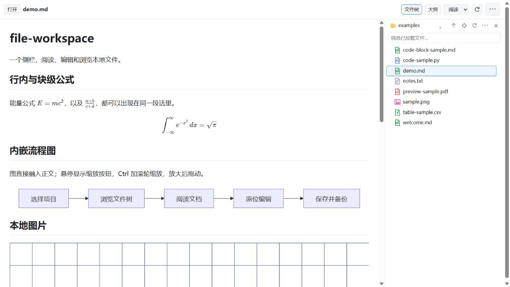
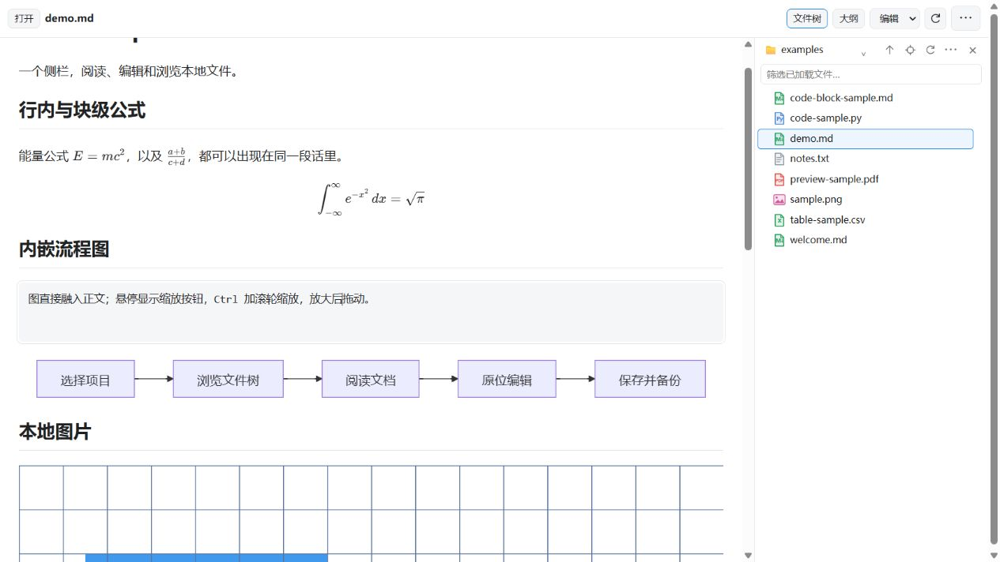

<div align="center">


<h1>file-workspace</h1>

<p><strong>让 Codex 的右侧栏，成为你的文件工作台。</strong></p>
<p>浏览项目 · 阅读文档 · 就地编辑 · 引用到对话</p>

<p>
  <a href="https://github.com/HuSiyue-ai/file-workspace/actions/workflows/check.yml"></a>
  <a href="https://github.com/HuSiyue-ai/file-workspace/tags"></a>
  <a href="LICENSE"></a>
  <a href="docs/installation.md"></a>
</p>

<p><strong>简体中文</strong> · <a href="README.en.md">English</a></p>

<p>
  <a href="#核心体验">核心体验</a> ·
  <a href="#快速开始">快速开始</a> ·
  <a href="#支持的文件">支持的文件</a> ·
  <a href="docs/installation.md">安装文档</a> ·
  <a href="https://github.com/HuSiyue-ai/file-workspace/issues">反馈问题</a>
</p>

</div>



**file-workspace** 是一个运行在 Codex 桌面端右侧栏的本地文件插件。用同一棵文件树浏览 Markdown、图片、PDF、代码和表格；读到需要修改或讨论的地方，就地编辑，或把引用与评论带入当前对话。

## 核心体验

### 一个文件树，连续浏览整个项目

单击文件，在当前页切换预览；目录始终留在身旁。

- **熟悉的目录操作**：单击文件夹展开 / 收起，双击进入，支持返回上级、定位当前文件和切换项目根目录。
- **为阅读留出空间**：文件树与正文并排，拖动边界调整宽度，收起后正文恢复全宽。
- **常用操作就在手边**：筛选已加载文件、复制路径、新建文件夹，以及将文件添加到聊天。双击文件交给 Codex 打开。

### 保持预览，只编辑需要改的那一段

切到「编辑」，点击一个块，只有这一块展开 Markdown 源码；离开后恢复排版，其余内容保持渲染。需要调整整篇结构时，也可以切到源码模式。



**修改由你决定何时落盘。** 点击「保存」或按 `Ctrl+S` 写回文件；保存前检查文件是否被外部修改，并保留原文件备份。

### 公式、图表和图片，直接融入文档

- **公式**：KaTeX 渲染行内与块级公式，支持段落、列表和引用中的混排。
- **流程图**：Mermaid 内嵌正文；悬停显示缩放控件，支持 `Ctrl` / `⌘` + 滚轮缩放，放大后可拖动。
- **本地图片**：支持相对路径、中文与空格路径、引用式图片及 Obsidian 图片语法；独立图片可缩放、拖动、适应窗口或按原始大小查看。
- **选区评论**：选中文字，写下评论，用编号气泡回看修改，再把引用和评论加入聊天草稿，由你确认发送。

## 快速开始

**需要：** Python **3.12+**、支持本地插件与 MCP App 文件入口的 **Codex 桌面端**，以及可运行 `codex plugin` 的 CLI。当前以 Windows 为主要验证环境；文件选择对话框需要 Tkinter。

### 1. 获取并构建

将仓库放在打算长期保留的位置，然后在 PowerShell 中运行：

```powershell
git clone https://github.com/HuSiyue-ai/file-workspace.git
cd file-workspace
python build.py
python doctor.py
```

### 2. 注册并安装

在仓库根目录继续运行：

```powershell
codex plugin marketplace add .
codex plugin add markdown-math-preview@markdown-preview-local
```

`markdown-math-preview` 是为兼容旧版本保留的内部标识，安装后显示的名称是 **file-workspace**。本项目需要本地构建，不能跳过构建、直接把 GitHub 地址当作即装即用的插件源。

### 3. 打开你的第一个文件

1. 完整退出 Codex（包括托盘），重新启动。
2. 在右侧打开一个 Markdown 或图片，在「打开」菜单中选择应用内查看器 **file-workspace**。
3. 打开「文件树」，单击其他文件，即可在同一页切换预览。

也可以从新标签页的插件工具入口进入空白工作台，再选择项目文件夹；入口位置依宿主版本而异。先打开 [示例文档](examples/demo.md) 即可体验公式、流程图和本地图片。

> 找不到入口、需要升级或回退？查看 [完整安装指南](docs/installation.md)。`python doctor.py` 只检查环境，不会自动安装软件或修改设置。

<details>
<summary><strong>需要预览 PDF？安装这两个可选依赖</strong></summary>

```powershell
python -m pip install -r requirements-pdf.txt
```

PDF 使用 `pypdfium2` 与 `Pillow`。插件优先使用可用的 Codex PDF 运行时，否则使用构建时的 Python；也可通过 `FILE_WORKSPACE_PDF_PYTHON` 指定解释器。运行 `python doctor.py` 确认实际使用的环境。

</details>

## 支持的文件

| 文件 | 在工作台中可以做什么 |
| :--- | :--- |
| **Markdown** · `.md` / `.markdown` | 阅读、块编辑、整篇源码编辑、大纲跳转、公式、Mermaid、本地图片 |
| **图片** · PNG / JPEG / GIF / WebP / SVG / BMP / ICO / AVIF | 缩放、拖动、适应窗口、原始大小；解码取决于宿主 |
| **PDF** · 可选依赖 | 翻页、缩放、书签、文字搜索 |
| **代码与文本** | 离线语法高亮、原文查看 |
| **CSV / TSV** | 分页、筛选、表头切换、原文查看 |
| **其他文件** | 在文件树中浏览，交给宿主打开 |

Markdown 编辑面向已有的 UTF-8 文档。PDF 暂不支持选文、OCR、表单与批注；Office、音视频和 Notebook 专用渲染尚不支持。完整的格式与大小限制见 [支持范围](docs/limitations.md)。

## 本地运行，明确保存

渲染库随插件打包，无需运行时请求 CDN。插件不上传文件、不联网拉取图片，也不执行文档中的代码。主动加入对话的引用进入聊天草稿，随后由 Codex 处理。

- **手动保存**：保存前校验原文件版本，检测到外部修改时拒绝覆盖。
- **原文备份**：保存到 `~/.codex/backups/file-preview/`，供需要时恢复。
- **批注暂存**：编号气泡与评论只保留在当前标签内存中，关闭标签前请先加入草稿。

文件访问以用户选定文件或项目建立锚点，后续可浏览**同一磁盘**，并非限制在项目目录内的沙箱。详见 [访问边界与兼容性](docs/limitations.md)。

## 常见问题

<details>
<summary><strong>它会替换 Codex 的内置文件查看器吗？</strong></summary>

它是一个应用内插件，有自己的文件树、编辑和批注界面，通过文件的「打开」菜单进入。顶部原生标签通常仍显示插件名，当前文件名在插件工具栏中显示；新开或复用原生标签由宿主决定。

</details>

<details>
<summary><strong>为什么项目目录有时没有自动识别？</strong></summary>

自动识别依赖宿主提供的信息与本机状态适配，宿主升级后可能需要调整。可从项目下拉菜单手动选择文件夹，继续使用文件树。

</details>

<details>
<summary><strong>支持哪些系统？是否需要 Node.js？</strong></summary>

目前主要在 Windows 验证，尚未保证其他系统与每个 Codex 桌面版本的兼容性。日常使用不需要 Node.js；开发检查需要。Python 解释器与源码目录需要持续可用，移动后应重新构建并安装。

</details>

## 文档与贡献

| 我想… | 从这里开始 |
| :--- | :--- |
| 安装、升级、回退或卸载 | [安装指南](docs/installation.md) |
| 查看格式限制与已知边界 | [支持范围](docs/limitations.md) |
| 理解服务、渲染器与编辑器 | [架构说明](docs/architecture.md) |
| 反馈问题或提交代码 | [贡献指南](CONTRIBUTING.md) · [Issues](https://github.com/HuSiyue-ai/file-workspace/issues) |
| 查看版本变更 | [更新记录](CHANGELOG.md) |

<details>
<summary><strong>本地开发与检查</strong></summary>

需要 Python 3.12+ 与 Node.js。在仓库根目录运行：

```powershell
python -m pip install -r requirements-dev.txt
python build.py
python check.py --require-pdf
```

检查覆盖文件读写、路径、保存冲突、目录、MCP 握手、前端状态回归、Markdown 解析、PDF 与第三方资源完整性。未安装 PDF 依赖时，可用 `python check.py` 检查其他功能。

`python dev_preview.py` 提供仅监听 `127.0.0.1` 的隔离调试界面，聊天草稿请求会被截获，不发送给真实聊天。它不能替代实际 Codex 桌面端测试。

</details>

## 许可与致谢

[MIT License](LICENSE) © HuSiyue-ai。第三方组件遵循各自许可证，详见 [第三方声明](THIRD-PARTY-NOTICES.md)。

感谢 [Marked](https://github.com/markedjs/marked)、[KaTeX](https://github.com/KaTeX/KaTeX)、[Mermaid](https://github.com/mermaid-js/mermaid)、[DOMPurify](https://github.com/cure53/DOMPurify)、[highlight.js](https://github.com/highlightjs/highlight.js) 与 [pypdfium2](https://github.com/pypdfium2-team/pypdfium2)。

由 **HuSiyue-ai** 基于实际使用需求设计与维护，开发使用 AI 辅助。项目仍在持续迭代，与 OpenAI 无隶属或背书关系。
