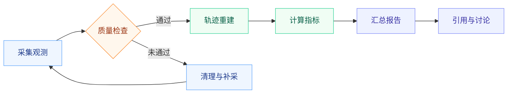

# 从原始观测，到可讨论的结论

> Mermaid 图表直接嵌入正文。读完流程，还可以继续阅读下面的解释。

## 实验数据流水线

## 为什么保留质量检查

低质量输入会同时影响误差与耗时。先检查观测完整性，再执行重建，可以让后续的对比更有解释力。

## 看清细节

悬停图表显示缩放按钮；按住 Ctrl 并滚动滚轮放大，放大后可拖动。图表原有占位高度保持不变，下面的正文不会被放大操作顶走。
